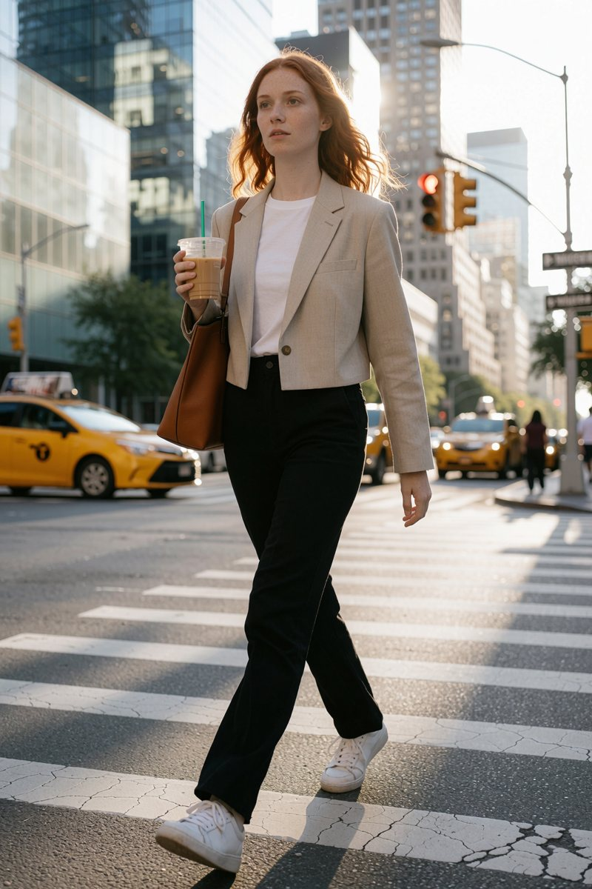
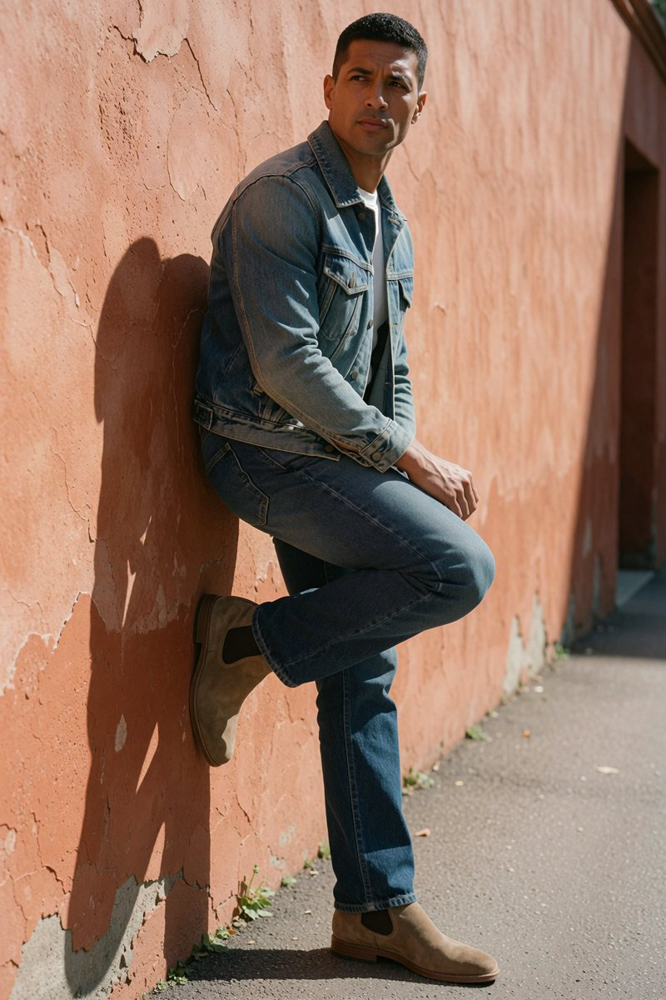
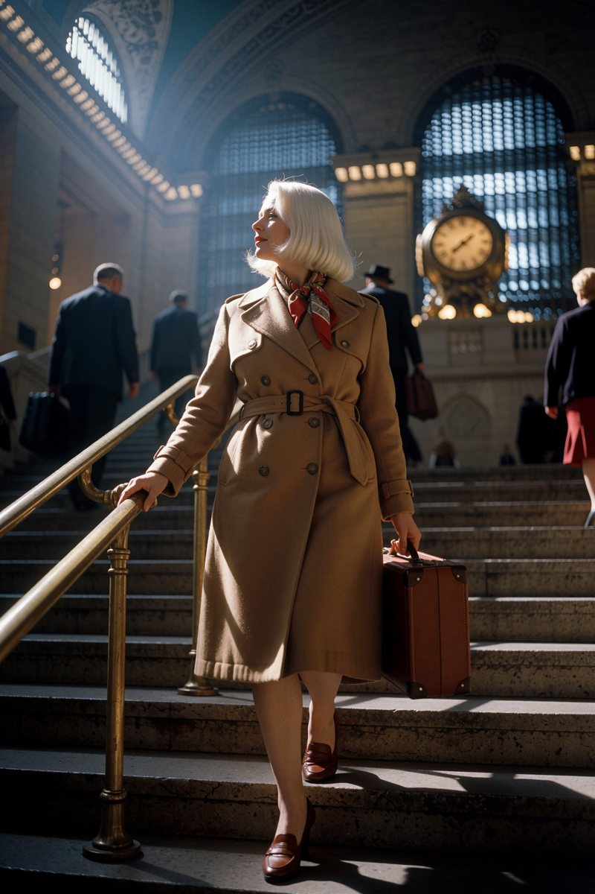
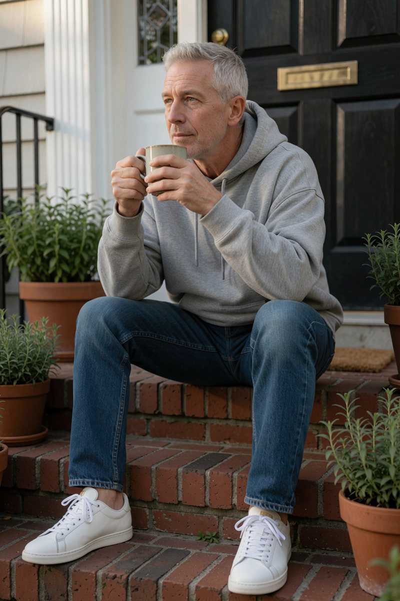
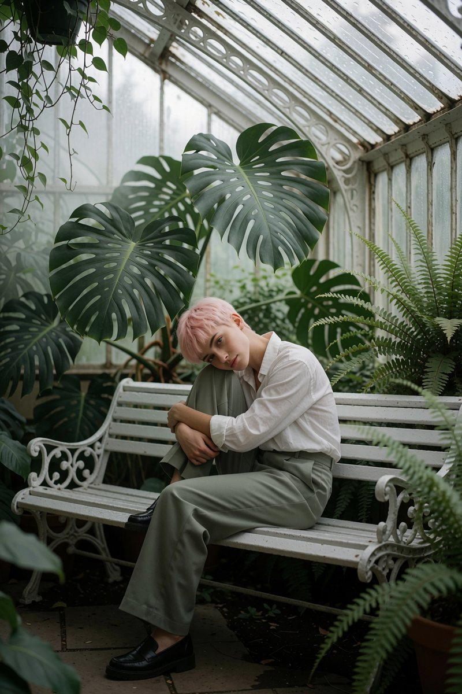
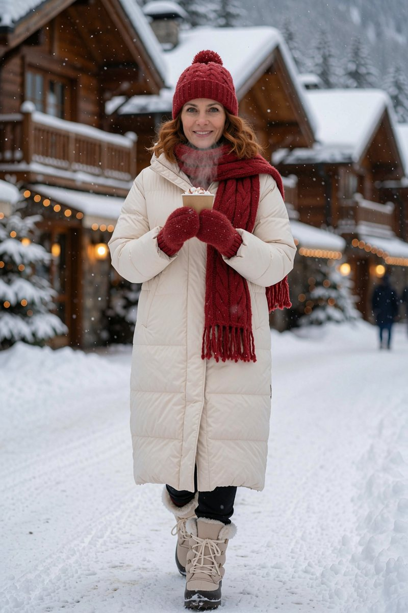
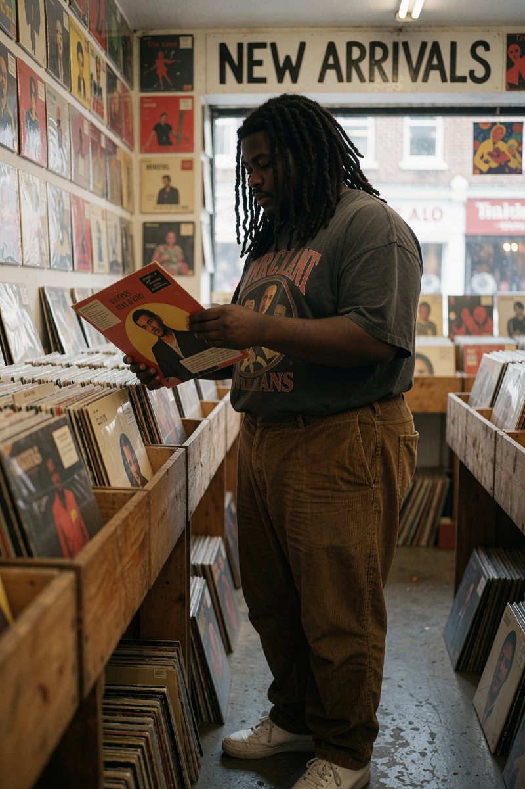
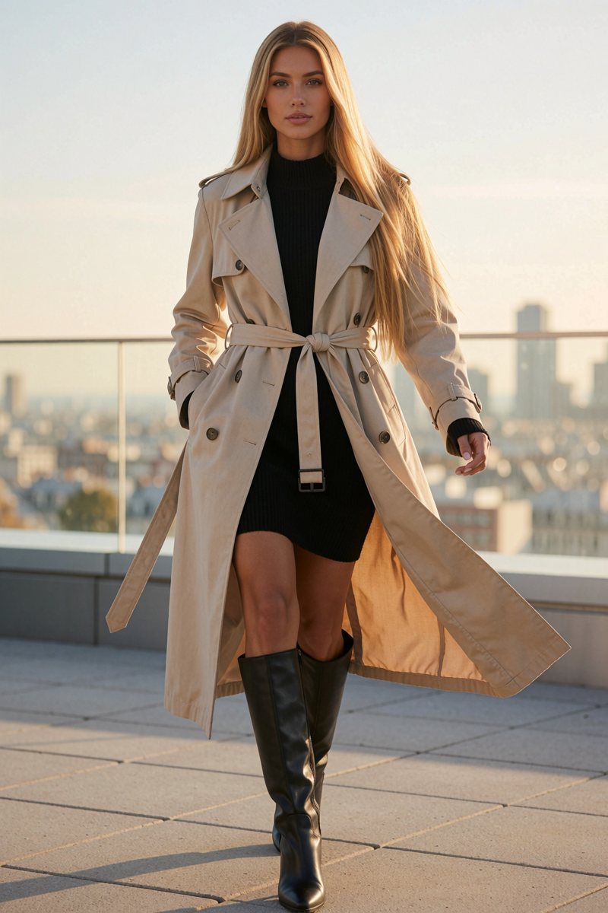

# Call Sheet

A Krea 2 shot builder for ComfyUI. Pick a pose, choose who is in the shot, what they wear and where it happens, and Call Sheet writes the prompt. Everything runs inside ComfyUI: a sidebar, a frame picker, and nodes you can find by typing **call sheet** in the node search.


<table class="gallery">
<tr><td width="25%" valign="top"><br><sub>Woman, 20s, slim, long wavy copper red hair, light freckles. Frame: Crosswalk mid stride. Camera: Phone snapshot.</sub></td><td width="25%" valign="top"><br><sub>Man, 30s, athletic, very short jet black hair, medium brown skin. Frame: Foot on the wall.</sub></td><td width="25%" valign="top"><br><sub>Woman, 40s, curvy, sleek platinum bob, porcelain skin. Frame: Station staircase. Look: Kodachrome.</sub></td><td width="25%" valign="top"><br><sub>Man, 60s, broad shouldered, silver gray hair, blue eyes. Frame: Front steps with coffee. Outfit: gray hoodie, jeans, sneakers.</sub></td></tr>
<tr><td width="25%" valign="top"><br><sub>Androgynous, 20s, lanky, pastel pink pixie cut, olive skin. Frame: Greenhouse bench. Outfit: white shirt, sage trousers, loafers.</sub></td><td width="25%" valign="top"><br><sub>Woman, 50s, average build, wavy auburn hair, hazel eyes. Frame: Snowy village street.</sub></td><td width="25%" valign="top"><br><sub>Man, 20s, plus size, long locs, ebony skin. Frame: Record store crates. Camera: 2000s digicam.</sub></td><td width="25%" valign="top"><br><sub>Woman, 20s, tall, toned, very long honey blonde hair. Frame: Studio walk, hand in pocket. Scene: Rooftop at golden hour.</sub></td></tr>
</table>

<sub>Each of these came from a Call Sheet prompt set up in a few clicks, rendered with Krea 2 at CFG 1 and 8 steps. The [tutorial](docs/TUTORIAL.md) shows how.</sub>

## Tutorial

New to Call Sheet? The [tutorial](docs/TUTORIAL.md) walks through the Studio, every tab and the single nodes, with screenshots and example renders. There is also a [PDF version](docs/Call-Sheet-Tutorial.pdf) you can download.

## Install

**ComfyUI Manager:** click **Install via Git URL**, paste `https://github.com/HyperFabrications/comfyui-call-sheet`, then restart ComfyUI.

**By hand:**

```
cd ComfyUI/custom_nodes
git clone https://github.com/HyperFabrications/comfyui-call-sheet
```

Restart ComfyUI. There are no extra Python packages to install.

## Getting updates

In ComfyUI Manager, click **Update** on Call Sheet (or run `git pull` in its folder), then restart ComfyUI and hard refresh the browser. Installs from before the rename keep updating, because GitHub forwards the old address. The folder name in `custom_nodes` doesn't matter.

If you installed before November 23, 2026 (v1.20.4) and Update fails, the history was rebuilt then. Back up your `custom_*.json` files and the `thumbs` folder, delete the plugin folder, install again and copy them back. The [tutorial](docs/TUTORIAL.md#15-tips-and-common-questions) has the steps.

## The nodes

| Node | What it does |
| --- | --- |
| **Call Sheet** | The whole shot on one node. Its card shows the frame, the prompt and four chips for Person, Outfit, Scene and Camera. Click **Open Studio** or a chip to set everything in one editor. Same outputs and modes as the Shot node. Link a Person, Outfit, Scene or Camera node to any of its inputs and that node takes over that part, so one outfit or scene can feed many shots. |
| **Call Sheet Shot** | Pick a frame and output its prompt, a starting shot written the way Krea 2 reads it, ready for you to build on. Person, Outfit, Scene and Camera swap in their part of the shot. Choose `single frame`, `whole set` or `whole tab`. Outputs `prompt` (one prompt, or all of them one per line), `prompt_list` (a list, so the graph runs once per prompt) and `count`. |
| **Call Sheet Person** | Describe who is in the shot. Link it to the Shot node's `person` input. |
| **Call Sheet Scene** | Build a setting once and use it with any pose. Link it to the Shot node's `scene` input. Its `text` output is the scene on its own. |
| **Call Sheet Outfit** | Put together an outfit and use it with any pose. Link it to the Shot node's `outfit` input. Its `text` output is the outfit on its own. |
| **Call Sheet Camera** | Pick what the shot was taken on and how it looks. Cameras: phone snapshot, mirror selfie, direct flash, 90s disposable, film SLR, 2000s digicam, each with its own flaws. Looks: film stocks and grades, black and white, kinds of light (golden hour, neon, Rembrandt and more), genres, and art styles (anime, watercolor, oil, charcoal, comic ink, 3D, pin up) that change the medium. Real skin adds pores and texture. Link it to the Shot node's `camera` input. It works with style off too. |

## The Studio

The Studio is the editor for the **Call Sheet** node. Tabs across the top for **Frame**, **Person**, **Outfit**, **Scene** and **Camera**, the groups down the left with what each is set to, the choices in the middle and a preview on the right. The finished prompt runs along the bottom, and changes apply as you make them.

- **Frame.** Search all frames, or browse Starred, Recent, each tab and Custom. The right side holds the mode, trigger, style switch, **Edit prompt**, **Star**, **Use last render as preview** and the full picker.
- **Pose only.** Switch the Frame tab from **Full frame** to **Pose only** and each frame gives just its pose and framing, with no clothes, place, light or palette, so your Person, Outfit and Scene fill in the rest and nothing fights them. The frame's own light and film finish stay (without its palette colors) unless you pick Lighting in the Scene tab. Location locks don't apply. Only frames that have a pose line show while it's on (646 of them; poses that need their own location or garment are left out). Whole set and whole tab runs use only those frames.
- **Person, Outfit, Scene, Camera.** The same choices as the builders, with color swatches, **Whole outfit** or **Just what I pick**, clean plate, flaws, looks and real skin. A frame that needs its own clothes or location says so, with **Use outfit anyway** or **Use scene anyway**. **Saved** loads and saves people, outfits and scenes (shared with the builders).
- **+ Add in every group.** Add your own hair color, body type, location, mood, camera, flaw, look and more. Name it and write how it reads in the prompt. Hover your own choice and press **×** twice to delete it. Your choices are saved on your computer in `custom_choices.json`, never uploaded, and every node that reads a person, scene or camera understands them.
- **Long lists stay short.** A long group shows its first choices and **+N more**. What you picked always stays visible, and an opened group of more than 16 gets a filter box.
- **⚙ Settings.** **All on one page** (every group in one scroll) or **One at a time** (one group as big cards, step through with ‹ ›), the **Preview** on or off, and **Color the prompt by layer** to underline what each tab wrote.

## Picking a frame

- **Frame picker.** Click the frame card on the Call Sheet Shot node (or **Open the pose gallery** in the sidebar) to browse every frame. Search, pick a tab, or use **Filter** for set, camera (overhead, close-up, low angle and more) and light (flash, window light, overcast and more). Click a card to load its prompt into an editable box (faint labels mark the subject, pose, clothes, setting, camera, light and look; **Hide labels** turns them off), check what the node will receive, then press **Use this frame**. **‹ ›** on the node step through frames one at a time.
- **Edit a prompt.** Type straight into the prompt box in the picker, or use **Edit prompt** on the node or **Edit** in the sidebar. Your version is used everywhere you pick that frame and is saved inside the workflow. **Reset** brings back the original.
- **Preview images.** Render a frame, then press **Use last generation as preview** in the picker. That image shows on the frame's card and on the node from then on. Previews stay on your computer in the `thumbs` folder.
- **Starred, Recent and Random.** Star frames to keep them in Starred, find the frames you used lately in Recent, or press **Random** for a surprise pick from what's shown.
- **Keyboard.** Arrow keys move through frames, Enter uses the selected frame, Esc closes the picker.

## Your own prompts

- **New prompt.** Press **New prompt** in the picker, name it, and write it with `[trigger]` where your trigger or person should go. It lands in the **Custom** tab and works in the node like any other frame.
- **Duplicate to Custom.** Copy any frame into your Custom tab as a starting point.
- **Import a list.** In the Studio's Custom group, press **Import a list** and paste your prompts, one per line, or choose a .txt file. Each one becomes a custom prompt. A short line right above a prompt becomes its name, otherwise the name comes from the pose. Bullets, numbers and quotes are dropped, and `[trigger],` goes in front where it's missing, with all your words kept. Prompts you already have are skipped.
- **Export and import.** In the Custom tab, **Export** saves your prompts as a file and **Import** adds prompts from that file or from a .txt list. Importing only ever adds.
- Custom prompts are saved on your computer in `custom_prompts.json` in the plugin folder. They are never uploaded and are kept when you update.

## The person

- **Person builder.** Open it with **Build person** on the Person node, or **Edit** in the picker's header. Pick gender, age, build, height, hair, eyes, skin and complexion, and a neutral figure updates as you go. Anything left on Any is up to Krea 2.
- **Age.** Adult ranges only: young adult (20s), 30s, 40s, middle aged (50s), older (60s) and elderly (70s+).
- **Edit the wording.** The builder shows the description it writes in a box you can type in, and the picker shows the same box above the prompt whenever the person is on. Your wording is used everywhere until you press **Reset** or change a trait, which rebuilds it from your picks.
- **Saved people.** **Save this person** keeps the current picks under a name you choose. Click a saved person to load them.

## The scene

- **Scene builder.** Press **Build scene** on the Scene node. Pick a location, time of day, weather, lighting (16 setups, from golden side light and light through blinds to a single lamp or a spotlight), era and mood, or choose one of the **Places**. The frame's own setting (and its light line, if you picked lighting) is swapped for yours. The pose, clothes, camera and finish stay.
- **Your own places.** In **Places**, press **New place** and give it a name, a setting and an optional light line. **Help me write it** offers starter ideas and asks what's behind, what's underfoot and one small detail, then writes the setting for you. Places are saved on your computer in `custom_places.json`, never uploaded, with **Import**, **Export** and **×** to delete.
- **Clean plate.** Turn on **Clean plate** to get the same shot with nobody in it: the frame's look, camera and light, in your scene.
- **Frames that need their own location.** Some poses rely on something in their setting, like a railing, a bed or a car. Those show a lock and keep their own setting, and **Works with scenes** in the picker shows only the frames a scene can move. **Use scene anyway** applies it to a locked frame with a warning. Your own prompts have a **Portable** switch for the same thing.
- **Saved scenes.** **Save this scene** keeps your picks under a name, with **Import** and **Export** to share them.
- With no scene linked, or **Use this scene** off, every prompt is exactly as before.

## The outfit

- **Camera and look.** Press **Camera and look** on the Camera node. On the Camera tab, pick a camera, turn its flaws on or off and turn on Real skin if you want it. On the Look tab, pick a film or grade, a light, a genre or an art style. A look replaces the frame's palette (and its light, for light looks); an art style turns the photo into that medium. **On a frame** shows the result in a real prompt. The idea for looks came from the [Clio Style Library](https://github.com/lumenastrum/clio-style-preview); the wording here is our own.
- **Outfit builder.** Press **Build outfit** on the Outfit node. Pick a top, bottoms or a one piece, outerwear, shoes and any number of accessories, each in one of 14 colors. A figure shows the outfit as you go, and **On a frame** shows it written into a real prompt.
- **Whole outfit or just what I pick.** **Whole outfit** replaces everything she wears in the frame (makeup stays). **Just what I pick** swaps only the pieces you chose: pick a coat and the frame keeps its own top, jeans and shoes under it. A one piece replaces the top and bottoms, and outerwear goes over whatever she has on.
- **Your own items.** In **Your items**, press **New item**, name it, choose what kind of piece it is and write how it reads. **Help me write it** offers starter ideas and asks for cut, color, fabric, the piece and one detail, then writes it for you. **Color** sets the piece's color: a named swatch also changes the color word in the wording, **Any color** opens a full picker for the figure, and **Auto** follows the wording. Edits to an item, a place or a custom prompt make ComfyUI run the graph again. Items are saved on your computer in `custom_outfit_items.json`, never uploaded, with **Import**, **Export** and **×** to delete.
- **Frames that rely on their clothes.** Some poses use a garment, like hands in trouser pockets or a skirt held out. Those keep their own clothes and show **Keeps its own clothes** in the picker. **Use outfit anyway** applies the outfit to that frame with a warning. Your own prompts work with outfits when they have a sentence starting with *Wearing*.
- **Saved outfits.** **Save this outfit** keeps your picks under a name, with **Import** and **Export** to share them. Your own items travel with a saved outfit.
- With no outfit linked, or **Use this outfit** off, every prompt is exactly as before. With both an outfit and a scene linked, the outfit goes on first, then the scene.

## The sidebar

Open the **Call Sheet** tab in ComfyUI's left sidebar. Type your LoRA trigger once and every prompt fills it in. Turn **Style** off to strip film, grain and palette words when a LoRA should supply the look, use **Build a person** to describe who is in the shot, and ☆ to star favorites.

- **To node** adds a Call Sheet Shot node set to that frame, or updates the selected one.
- **To text box** fills the selected text node. If none is selected, it uses the one feeding your sampler's positive input, or the only text node on the canvas. The button tells you where the prompt went.
- **Set to node** adds a Shot node that outputs the whole set as a list.

## Settings that work

- Krea 2 Turbo: 8 steps.
- CFG `1.0` on the stock KSampler. Krea's own tools use 0.0, which breaks the image in KSampler.
- Render at full size (trained up to 2048×2048) instead of upscaling.
- Match the canvas to the shot: wide for side views, tall for full length.

## Optional: web page on GitHub Pages

The same sheet can be published as a web page. In the repo, go to Settings → Pages → Source: **GitHub Actions**, then run **Publish web sheet to GitHub Pages** from the Actions tab. The sheet appears at `https://hyperfabrications.github.io/comfyui-call-sheet/`.

## Optional: publish to the Comfy Registry

1. Sign in at [registry.comfy.org](https://registry.comfy.org) with GitHub and create a publisher. Put its id in `pyproject.toml` as `PublisherId`.
2. On the registry, create an API key for that publisher.
3. In this repo on GitHub: Settings → Secrets and variables → Actions → New repository secret, named `REGISTRY_ACCESS_TOKEN`, with the key as its value.
4. From then on, every push to `main` that changes the version in `pyproject.toml` publishes automatically. You can also run **Publish to Comfy Registry** by hand from the Actions tab.

## Files

| Path | What it is |
| --- | --- |
| `web/poses.json` | All prompts, sets, person traits and the changelog |
| `web/core.js` | Prompt logic: trigger, Style off, person text |
| `web/sheet.js`, `web/sheet.css` | The sheet interface, shared by the sidebar and the web page |
| `web/gallery.js` | The frame picker and the prompt editor |
| `web/builder.js`, `web/figure.js` | The person builder and its figure |
| `custom.py`, `web/custom.js` | Your own prompts (Custom tab), saved locally |
| `web/pose_sheet.js` | ComfyUI sidebar tab, node cards and Send buttons |
| `thumbs.py` | Saves and serves your preview images |
| `nodes.py`, `pose_data.py` | The nodes (`pose_data.py` mirrors `core.js`) |
| `web/scenes.json` | Scene options and which frames keep their own location |
| `scene_data.py`, `web/scene_core.js` | Scene logic: swap the setting, clean plate (`scene_data.py` mirrors `scene_core.js`) |
| `web/scene.js`, `web/scene_art.js` | The scene builder and its picture |
| `places.py` | Your own places, saved locally |
| `web/outfits.json` | Clothing options, colors and which frames keep their own clothes |
| `outfit_data.py`, `web/outfit_core.js` | Outfit logic: read and swap the clothing line (`outfit_data.py` mirrors `outfit_core.js`) |
| `web/outfit.js`, `web/outfit_art.js` | The outfit builder and its figure |
| `outfit_items.py` | Your own clothing items, saved locally |
| `nodes.py` `KreaCallSheet`, `web/studio.js` | The Call Sheet node and the Studio |
| `choices.py`, `web/choices.js` | Your own Studio choices, saved locally in `custom_choices.json` |
| `web/cameras.json` | The cameras and their flaws, the looks and art styles, and the real skin options |
| `camera_data.py`, `web/camera_core.js`, `web/camera.js` | Camera logic (`camera_data.py` mirrors `camera_core.js`) and the camera picker |
| `site/index.html` | The GitHub Pages page |
| `scripts/` | `release.py`, `validate.py`, `build_site.sh`, `sync_from_artifact.mjs` |
