# Call Sheet tutorial

Call Sheet writes Krea 2 prompts for you inside ComfyUI. You pick a starting shot (a "frame"), say who is in it, what they wear, where they are and what camera took the picture, and Call Sheet puts it together as a prompt in the order Krea 2 reads best. That prompt is a starting point. Most people render it once, see what they like, and then keep writing on top of it.

This tutorial has two parts. The first walks through the **Call Sheet** node and its Studio, which is the easiest way to use the plugin. The second covers the single nodes (Person, Outfit, Scene, Camera and Shot) and shows how to use them on their own, including in your own prompts that have nothing to do with the Call Sheet frames.

You don't need to know how Krea 2 likes its prompts to follow along. You only need ComfyUI and a Krea 2 model.

## What you can make

Every image here came from a Call Sheet prompt with a few clicks in the Studio, rendered with the Krea 2 Soft NSFW checkpoint at CFG 1, 8 steps and 1024 × 1536, with no LoRA. Each caption says what was set in the Studio. The full prompts are in [examples/prompts.txt](examples/prompts.txt).

<table class="gallery">
<tr><td width="25%" valign="top">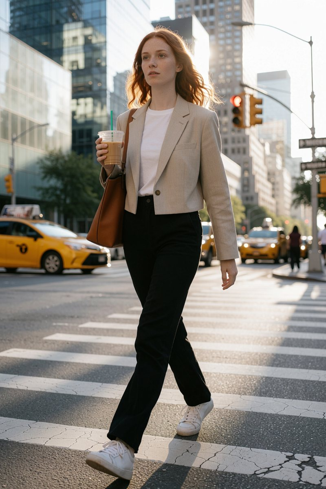<br><sub>Woman, 20s, slim, long wavy copper red hair, light freckles. Frame: Crosswalk mid stride. Camera: Phone snapshot.</sub></td><td width="25%" valign="top">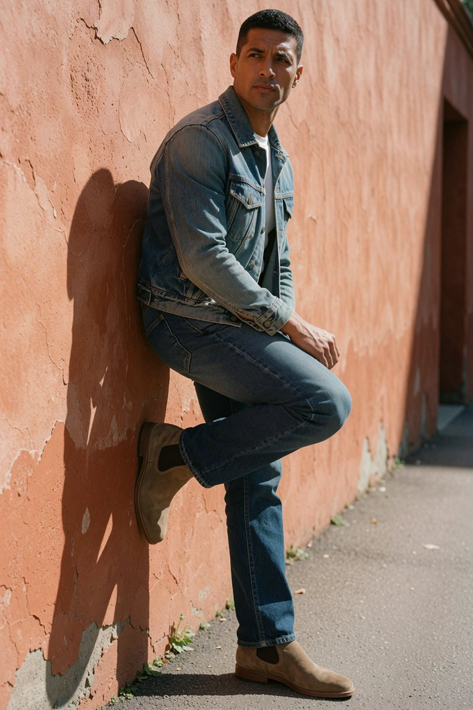<br><sub>Man, 30s, athletic, very short jet black hair, medium brown skin. Frame: Foot on the wall.</sub></td><td width="25%" valign="top">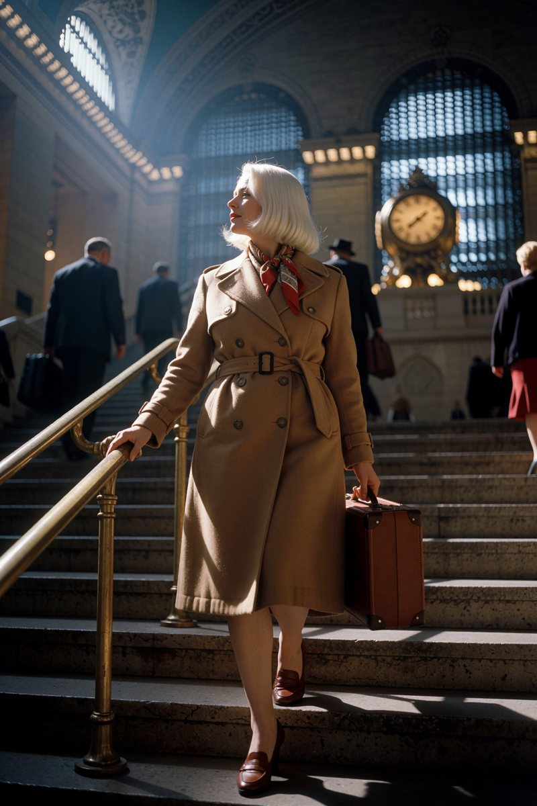<br><sub>Woman, 40s, curvy, sleek platinum bob, porcelain skin. Frame: Station staircase. Look: Kodachrome.</sub></td><td width="25%" valign="top">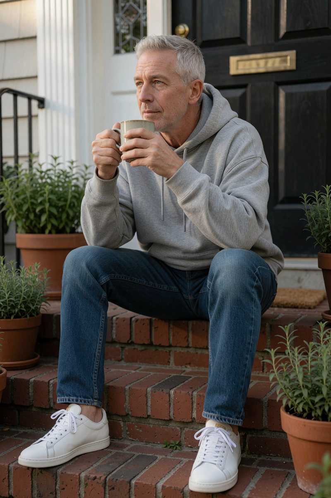<br><sub>Man, 60s, broad shouldered, silver gray hair, blue eyes. Frame: Front steps with coffee. Outfit: gray hoodie, jeans, sneakers.</sub></td></tr>
<tr><td width="25%" valign="top">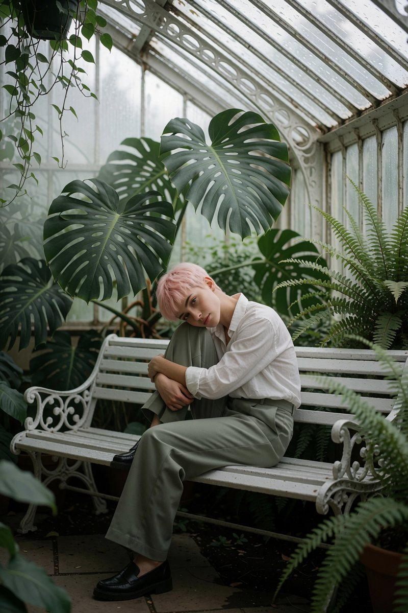<br><sub>Androgynous, 20s, lanky, pastel pink pixie cut, olive skin. Frame: Greenhouse bench. Outfit: white shirt, sage trousers, loafers.</sub></td><td width="25%" valign="top">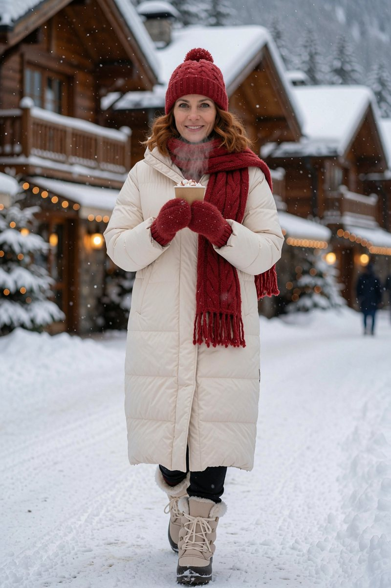<br><sub>Woman, 50s, average build, wavy auburn hair, hazel eyes. Frame: Snowy village street.</sub></td><td width="25%" valign="top">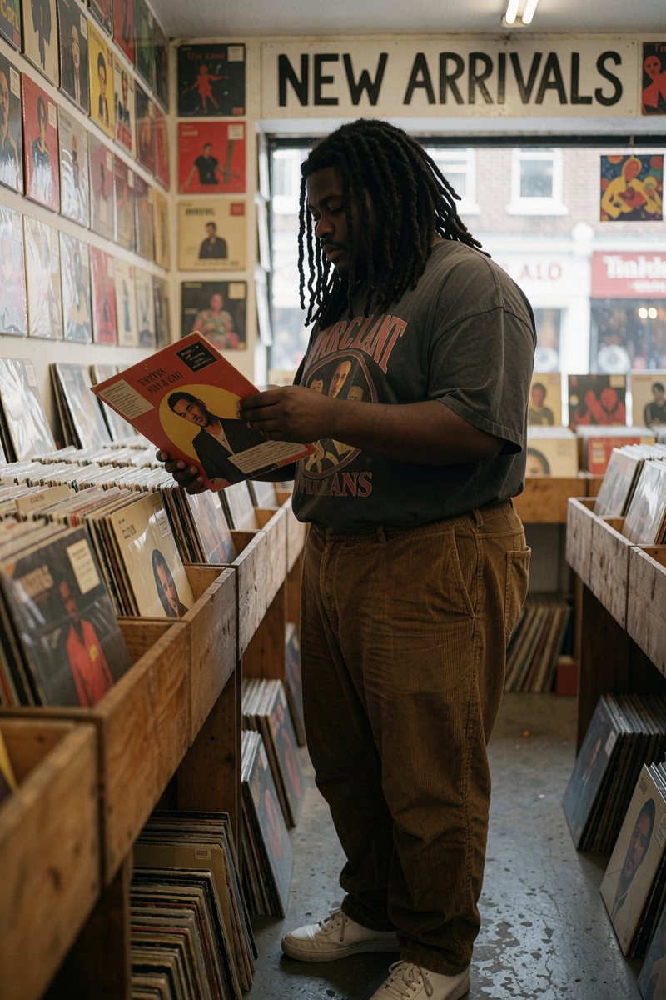<br><sub>Man, 20s, plus size, long locs, ebony skin. Frame: Record store crates. Camera: 2000s digicam.</sub></td><td width="25%" valign="top">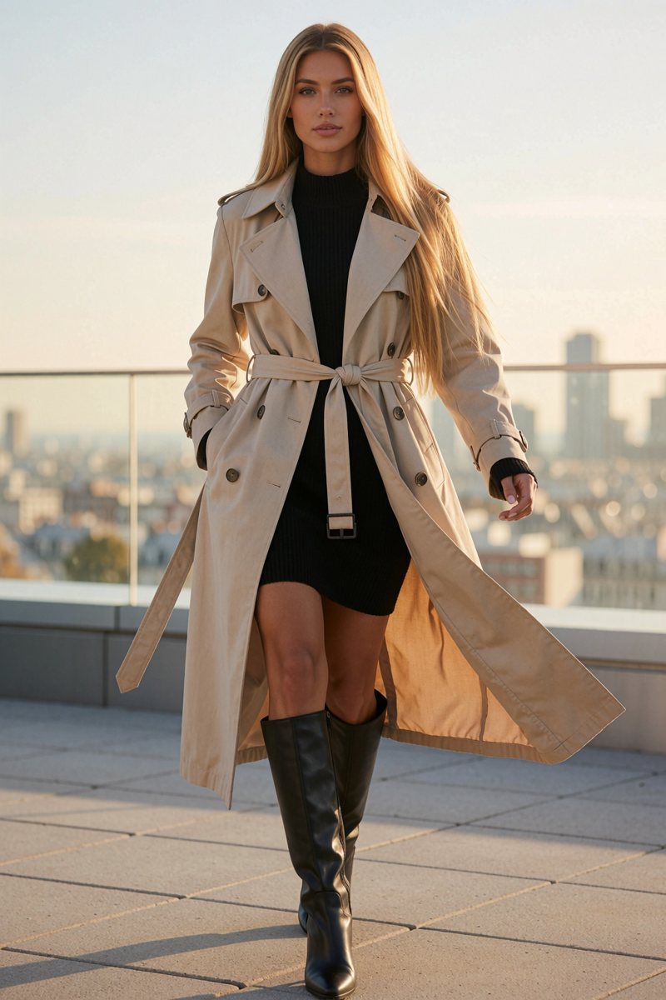<br><sub>Woman, 20s, tall, toned, very long honey blonde hair. Frame: Studio walk, hand in pocket. Scene: Rooftop at golden hour.</sub></td></tr>
</table>

## Contents

1. [Install](#1-install)
2. [Your first prompt](#2-your-first-prompt)
3. [The Studio](#3-the-studio)
4. [Pose tab](#4-pose-tab)
5. [Person tab](#5-person-tab)
6. [Outfit tab](#6-outfit-tab)
7. [Scene tab](#7-scene-tab)
8. [Camera tab](#8-camera-tab)
9. [Adding your own choices](#9-adding-your-own-choices)
10. [Your own prompts and importing a list](#10-your-own-prompts-and-importing-a-list)
11. [Studio settings](#11-studio-settings)
12. [The single nodes](#12-the-single-nodes)
13. [Using the single nodes outside Call Sheet](#13-using-the-single-nodes-outside-call-sheet)
14. [The Shot node, the frame picker and the sidebar](#14-the-shot-node-the-frame-picker-and-the-sidebar)
15. [Tips and common questions](#15-tips-and-common-questions)

## 1. Install

You can install Call Sheet with ComfyUI Manager or by hand.

**With ComfyUI Manager:** open the Manager, click **Install via Git URL**, paste `https://github.com/HyperFabrications/comfyui-call-sheet` and restart ComfyUI.

**By hand:** open a terminal in your ComfyUI folder and run:

```
cd custom_nodes
git clone https://github.com/HyperFabrications/comfyui-call-sheet
```

Then restart ComfyUI. There are no extra Python packages to install.

To check that it worked, double click an empty spot on the canvas and type **call sheet**. You should see six nodes: Call Sheet, Call Sheet Shot, Call Sheet Person, Call Sheet Outfit, Call Sheet Scene and Call Sheet Camera. A **Call Sheet** button also appears in ComfyUI's left sidebar.

## 2. Your first prompt

Call Sheet only writes text. You still need the usual parts of a text to image workflow: a model loader, a text encoder, a sampler and something to save the image. Here is the smallest setup that works.

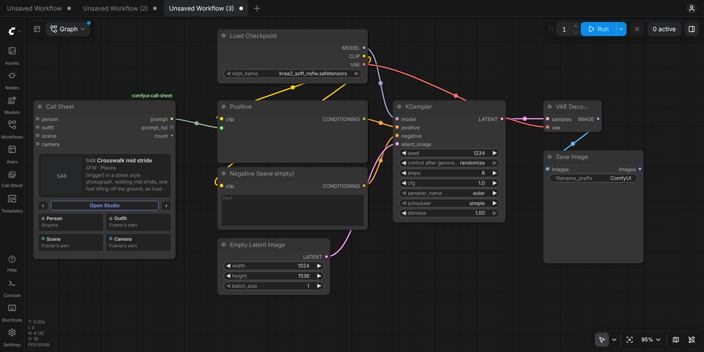

1. Start from any Krea 2 text to image workflow, or build one: **Load Checkpoint**, two **CLIP Text Encode** nodes (positive and negative), **Empty Latent Image**, **KSampler**, **VAE Decode** and **Save Image**.
2. Add a **Call Sheet** node.
3. Drag from the Call Sheet node's `prompt` output onto the `text` box of your positive CLIP Text Encode node. The text box turns into a link, which means the prompt now comes from Call Sheet.
4. Leave the negative prompt empty. Krea 2 at CFG 1 ignores it anyway.
5. Set the KSampler to **8 steps** and **CFG 1.0**. Krea's own tools use CFG 0, but in the stock KSampler that breaks the image.
6. Set the image size to suit the shot. Tall shots (full length, standing) look best at something like 1024 × 1536. Side views and wide scenes look best wide.
7. Press **Run**.

A new Call Sheet node starts on the first SFW frame, so you get an image straight away. Everything from here on is about choosing what goes into the prompt.

## 3. The Studio

Click **Open Studio** on the Call Sheet node. The Studio is a full screen editor where you set up the whole shot.

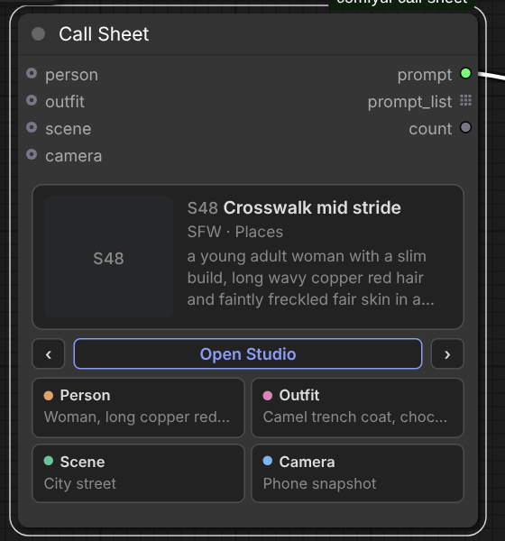

You can also click one of the four chips under Open Studio (Person, Outfit, Scene, Camera). Each one opens the Studio on that tab. The chips show what each layer is set to, so you can read the node without opening anything. "Frame's own" means that layer is not changing anything and the frame keeps its original wording.

Every tab in the Studio is laid out the same way:

- **Across the top** are the five tabs: Frame, Person, Outfit, Scene and Camera. A filled dot next to a tab means that layer is changing the prompt. A hollow one means it isn't.
- **On the left** is a list of the groups on that tab, with what each one is set to. Click a group to jump to it.
- **In the middle** are the choices. Click one to pick it. Click **Any** to clear a group.
- **On the right** is a preview, the things you picked (click × on one to remove it) and a **Use this ...** switch that turns the whole layer off without losing your picks.
- **Along the bottom** is the finished prompt. It updates as soon as you click. Each part is underlined in its tab's color, so you can see which words came from which tab. **Copy** puts the prompt on your clipboard.

At the top right are **Reset** (clears the tab you're on, nothing else), the gear for [settings](#11-studio-settings) and **Done**. Your changes are saved as you make them, so Done only closes the Studio.

## 4. Pose tab

A frame is a ready-made shot: a pose, clothes, a setting, a camera angle, light and a look, already written the way Krea 2 likes. The other four tabs change parts of it.

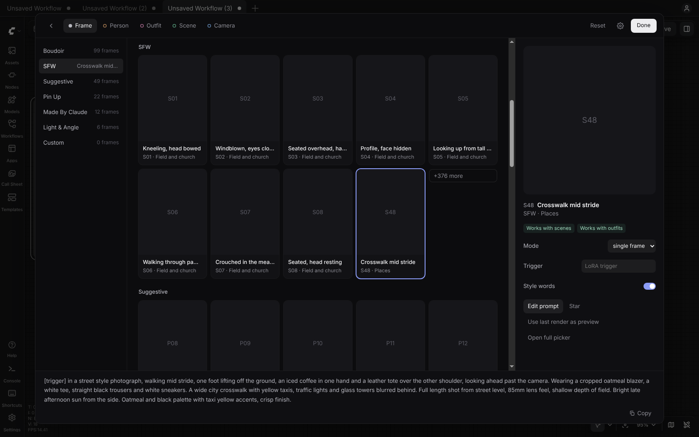

Frames are grouped into tabs, such as SFW, Boudoir, Pin Up and Light & Angle, and then into sets. Click a group on the left to jump to it. Long groups show their first few frames and a **+N more** button. To find something specific, type in **Search all frames** at the top (for example "crosswalk", "window" or "overhead").

Click a frame to use it. The prompt at the bottom changes right away.

The right side of the Pose tab holds the settings for the whole node:

- **Mode.** `single frame` gives you one prompt. `whole set` gives you every frame in the same set, and `whole tab` gives you every frame in the tab. In the set and tab modes the `prompt` output has all the prompts one per line, and `prompt_list` sends them as a list, so ComfyUI runs the rest of the graph once per prompt. Use `prompt_list` when you want to render a whole set in one go.
- **Trigger.** If you use a character or style LoRA, type its trigger word here. It goes where the frame says `[trigger]`. Leave it empty if you don't use a LoRA.
- **Style words.** Turn this off when a LoRA should supply the look. It strips the film, grain and color palette words so they don't fight the LoRA.
- **Edit prompt** opens the frame's text so you can change it. Your version is used every time you pick that frame in this node, and it is saved in the workflow. **Reset to sheet text** brings back the original.
- **Star** adds the frame to a Starred group at the top of the list. Frames you used recently show up in a Recent group too.
- **Use last render as preview** takes the last image you rendered and uses it as this frame's thumbnail, so the frame cards show real pictures instead of a number. Previews stay on your computer.
- **Open full picker** opens the bigger frame picker described in [section 14](#14-the-shot-node-the-frame-picker-and-the-sidebar).

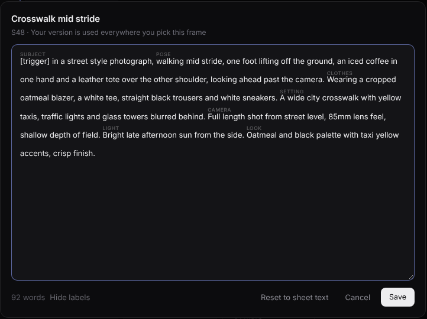

In the Edit prompt box, faint labels mark each sentence: subject, pose, clothes, setting, camera, light and look. They show you which part to change. **Hide labels** turns them off.

## 5. Person tab

The Person tab describes who is in the shot. Use it when you don't have a character LoRA. It opens on the four picks that change a picture most: gender, age, hair color and hair length. Body type, height, hair type, eyes, skin and complexion are under **More details**, and any you set stay open. If you have saved people, they show at the top as a place to start.

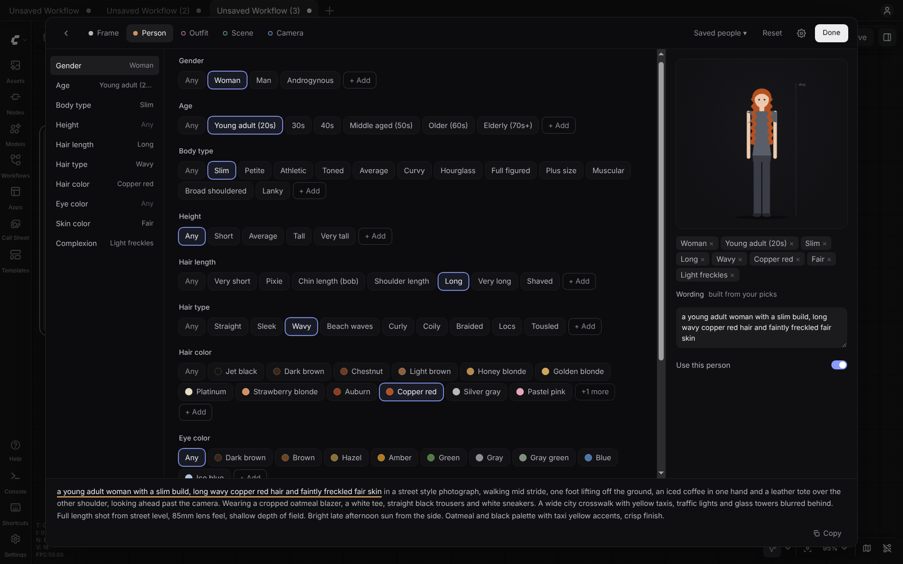

Pick from gender, age, body type, height, hair length, hair type, hair color, eye color, skin color and complexion. Anything left on **Any** is up to Krea 2, so you only need to pick what matters to you. Ages are adults only, from young adult (20s) up to elderly (70s+).

On the right, a simple figure updates as you pick, and the **Wording** box shows the exact description that goes into the prompt. You can type in that box to word it your own way. Your wording stays until you press its **Reset** link or change a pick, which rebuilds it from your choices.

**Saved people** (top right) saves the current person under a name so you can load them again later, in this node or any other.

> The frames are written about a woman. When you pick Man, Call Sheet changes "she" and "her" to "he" and "his" for you, in the frame and in the camera lines. The clothes stay as written, so use the Outfit tab if they don't suit the person.

## 6. Outfit tab

The Outfit tab changes what the person is wearing. You can put together a top, bottoms or a one piece, outerwear, shoes and any number of accessories. Pieces with a color show a row of swatches underneath, so you can pick the color too.

The switch at the top matters most:

- **Whole outfit** replaces everything the frame's person had on with exactly what you picked. If you only pick a coat and boots, they'll be wearing only a coat and boots.
- **Just what I pick** swaps only the pieces you chose and keeps the rest of the frame's outfit.

Here is the difference with the same picks, a camel trench coat and brown ankle boots:


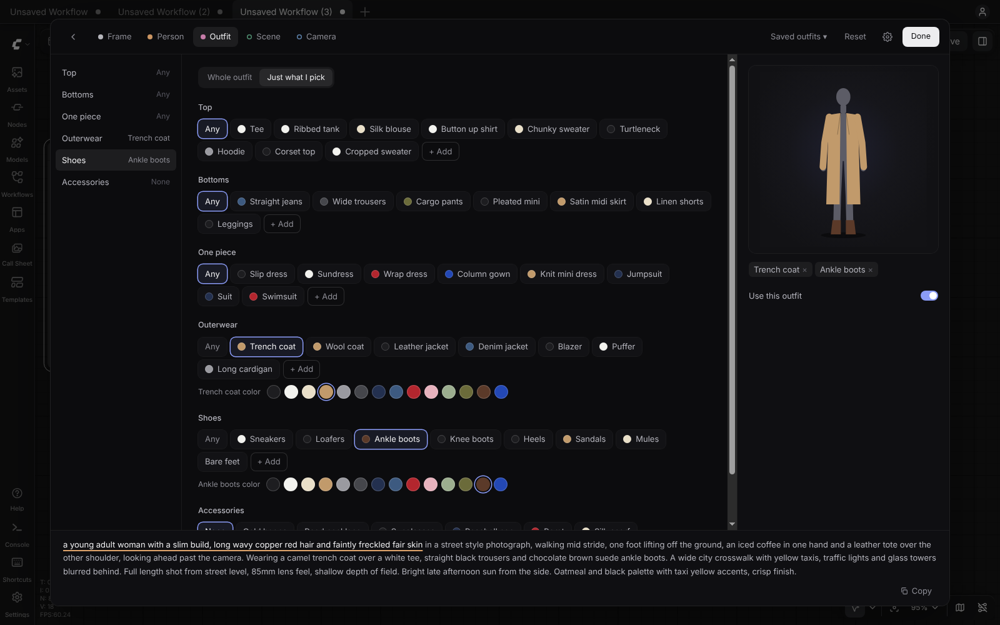

With **Just what I pick**, the trench replaced the frame's blazer and the boots replaced its sneakers, but the white tee and black trousers stayed.

Some frames rely on their own clothes. For example, a pose with hands in trouser pockets needs trousers. Those frames keep their clothes and tell you so, with a **Use outfit anyway** button if you want to override that.

**Saved outfits** works the same way as Saved people.

## 7. Scene tab

The Scene tab moves the shot somewhere else. It replaces the frame's setting sentence and keeps the pose, clothes, camera and look.

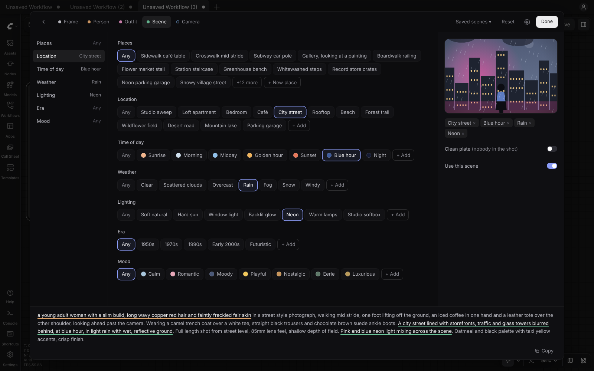

You can either pick one of the **Places** (ready-made settings taken from the frames) or build a setting from **Location**, **Time of day** and **Weather**. **Era** and **Mood** add a short line after the setting.

**Lighting** is worth knowing about. If you change the time of day but not the lighting, the frame keeps its own light sentence, and you can end up with a blue hour scene lit by "bright late afternoon sun". Pick a Lighting option and it replaces that sentence too. In the example above, Neon turned the light line into "Pink and blue neon light mixing across the scene".

The preview on the right is a small illustration of your scene.

**Clean plate** gives you the same shot with nobody in it: the frame's camera, light and look, in your scene. It's handy for backgrounds.

Some frames need their own location, like a pose leaning on a railing or sitting on a bed. Those show a lock and keep their setting. **Use scene anyway** overrides the lock.

## 8. Camera tab

The Camera tab changes what the photo was taken on and how it looks. This is where a lot of realism comes from.

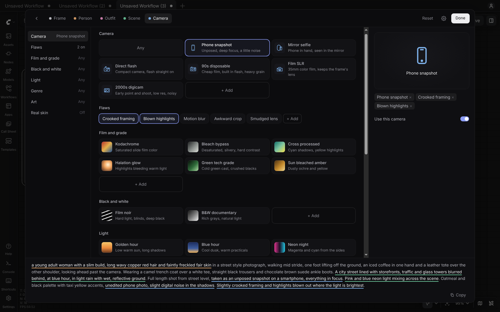

**Cameras.** Phone snapshot, Mirror selfie, Direct flash, 90s disposable, Film SLR and 2000s digicam. Each one replaces the lens and finish words in the prompt with its own.

**Flaws.** Each camera has its own small mistakes, like crooked framing, blown highlights, motion blur, a light leak or JPEG noise. Some are on by default. Click a flaw to turn it on or off.

**Looks.** Film and grade (Kodachrome, bleach bypass and more), black and white, kinds of light (golden hour, blue hour, neon night, Rembrandt and more), genres, and art styles. A look replaces the frame's color palette. Light looks also replace its light. Art styles (anime, watercolor, oil painting, charcoal, comic ink, 3D render, pin up painting) turn the whole thing into that medium, so the camera and real skin are skipped.

**Real skin** adds pores and natural skin texture. Turn it on with its switch and choose which details you want.

## 9. Adding your own choices

Every group in the Studio ends with **+ Add**. Use it when the choice you want isn't there. Give it a name (what you see on the button) and the words it should put in the prompt.

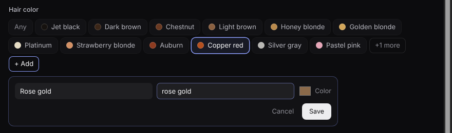

After you press **Save**, your choice shows up in the group with a small dot, and it's picked straight away. To delete one of your own choices, hover it, press **×**, then press it again to confirm.

Your choices are saved on your computer in `custom_choices.json` in the plugin folder. They are never uploaded, they survive updates, and every Call Sheet node can use them.

## 10. Your own prompts and importing a list

You can add your own prompts as frames. They live in the **Custom** group on the Pose tab, and the Person, Outfit, Scene and Camera tabs work on them like any other frame.

**New prompt** lets you write one. Put `[trigger]` where the person (or your LoRA trigger) should go.

**Import a list** adds many at once. Paste your prompts one per line, or choose a .txt file.

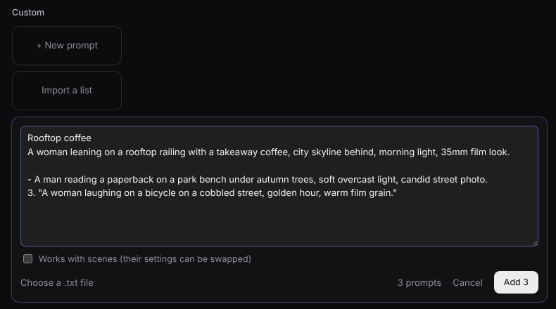

Call Sheet cleans up the list for you. It drops bullets, numbers and quotes. A short line right above a prompt becomes its name (like "Rooftop coffee" above). Otherwise the name comes from the pose. If a prompt starts with a plain "A woman", "A man" or "A person", that becomes `[trigger]`, and any other prompt without `[trigger]` gets it added at the front. Every other word is kept. Prompts you already have are skipped. Press **Add** and they appear in Custom.

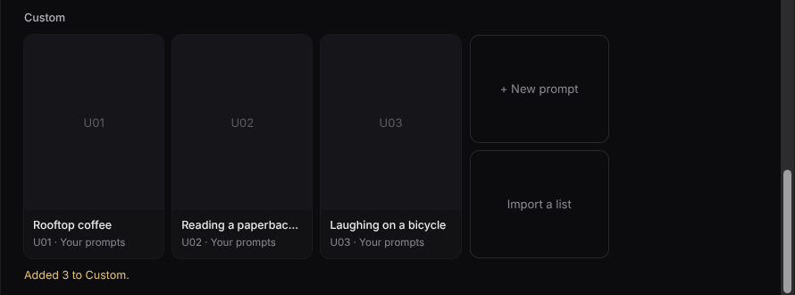

> When the Person tab is set, it takes the place of a plain "a woman", "a man" or "a person" right after `[trigger]`. A longer description, like "a young redhead woman", is kept as you wrote it, so with Person on you'd describe them twice. For prompts you plan to use with the Person tab, keep the subject plain or use **Edit prompt** to remove it.

Your prompts are saved on your computer in `custom_prompts.json`. They are never uploaded. In the full picker's Custom tab you can also **Export** them to a file and **Import** them on another computer.

## 11. Studio settings

The gear at the top of the Studio has a few display options. They're saved in your browser and apply to every tab.

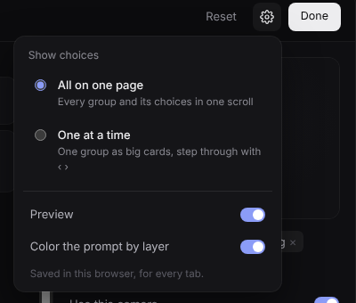

- **All on one page** shows every group in one scroll. This is the default.
- **One at a time** shows one group as big cards. Step through the groups with ‹ and ›. It's nice on a small screen.
- **Preview** shows or hides the figure and scene pictures on the right.
- **Color the prompt by layer** turns the colored underlines in the prompt on or off.

## 12. The single nodes

The Call Sheet node does everything in one place. The plugin also comes with each layer as its own node:

| Node | What it gives you | Outputs |
| --- | --- | --- |
| **Call Sheet Person** | A description of a person | `person` (text) |
| **Call Sheet Outfit** | An outfit | `outfit` (for Call Sheet nodes) and `text` (a "Wearing ..." sentence) |
| **Call Sheet Scene** | A setting | `scene` (for Call Sheet nodes) and `text` (the setting lines) |
| **Call Sheet Camera** | A camera and look | `camera` (for Call Sheet nodes) and `text` (the lines it adds) |
| **Call Sheet Shot** | A frame, with the other nodes plugged in | `prompt`, `prompt_list`, `count` |

Each single node has a button that opens its own builder: **Build person**, **Build outfit**, **Build scene** and **Camera and look**. They offer the same choices as the Studio tabs.

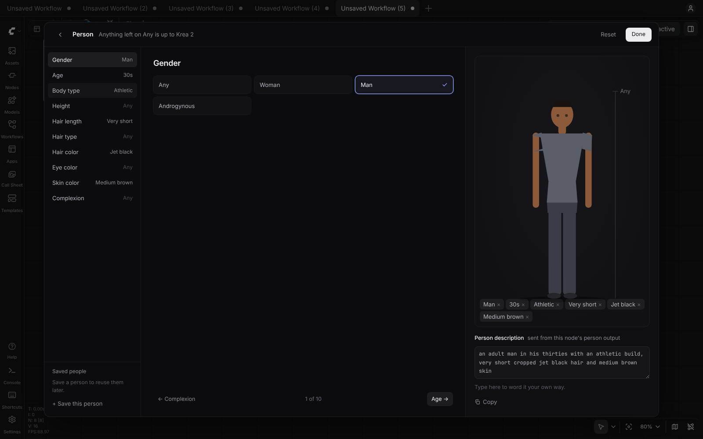

There are two ways to use them.

**Plugged into a Call Sheet or Shot node.** Link a Person, Outfit, Scene or Camera node into the matching input on a Call Sheet node and that node takes over that layer. The Studio tab then shows a link icon and says it's using the linked node. This is useful when several shots should share one person or one outfit. Set it once on a single node, link it to as many Call Sheet nodes as you like, and change it in one place.

**On their own,** as text you can use anywhere. That's the next section.

## 13. Using the single nodes outside Call Sheet

Every single node puts out plain text, so you can use it in any prompt, not only with the Call Sheet frames. The quickest way to see what a node writes is to connect its text output to a **Preview as Text** node (it comes with ComfyUI) and press Run. These nodes don't load any model, so this takes a second.

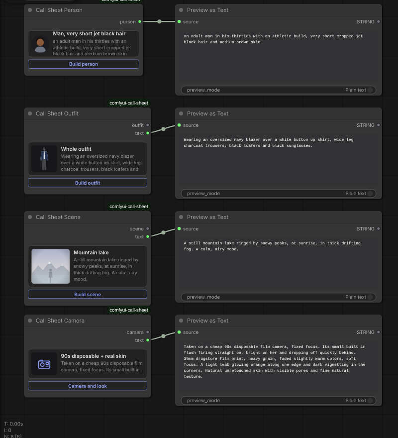

Here are three ways people use them.

### Copy a person into your own prompt

Say you already have a prompt you like, and you just want a consistent, well described person in it.

1. Add a **Call Sheet Person** node and click **Build person**.
2. Pick the traits you care about. Leave the rest on Any.
3. Under **Person description**, click **Copy**.
4. Paste it at the start of your own prompt and keep writing:

```
an adult man in his thirties with an athletic build, very short cropped jet black hair and medium brown skin, playing a battered upright piano in a dim jazz bar, a half full glass resting on the lid. Medium shot from the side at eye level, 35mm lens feel. Warm tungsten lamps and blue haze from a stage light behind. Late night film still, deep shadows, soft grain.
```

You don't even need the node in your workflow after that. It's a quick way to get the wording right.

### Join a person to your own text inside the graph

If you'd rather keep the person live (so you can change their hair and re-run without copying again), join it to your text with ComfyUI's built-in **Concatenate Text** node:

1. Link **Call Sheet Person** `person` into Concatenate Text's `string_a`.
2. Type the rest of your prompt in `string_b`.
3. Put a single space in `delimiter`.
4. Link the output into your positive CLIP Text Encode.

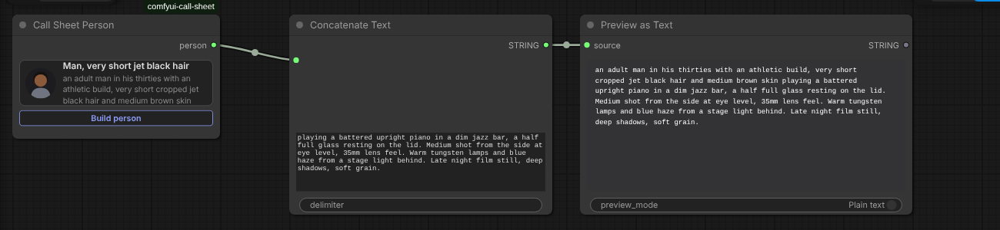

Now any change in the Person builder goes straight into your prompt on the next run.

### Use outfits, scenes and cameras the same way

The Outfit, Scene and Camera nodes work the same. Their `text` outputs give you:

- **Outfit:** a full sentence, like "Wearing an oversized navy blazer over a white button up shirt, wide leg charcoal trousers, black loafers and black sunglasses."
- **Scene:** the setting, like "A still mountain lake ringed by snowy peaks, at sunrise, in thick drifting fog. A calm, airy mood."
- **Camera:** the camera lines, like "Taken on a cheap 90s disposable film camera, fixed focus ..." plus any flaws and real skin.

You can chain several Concatenate Text nodes to build a whole prompt from parts: person, then your action, then the outfit, then the scene, then the camera. That order follows the way Krea 2 reads a prompt (subject, what they're doing, clothes, setting, camera, light, look).

## 14. The Shot node, the frame picker and the sidebar

### Call Sheet Shot

The **Call Sheet Shot** node is the older, wired way of doing what the Call Sheet node does. It picks a frame and has inputs for `person`, `outfit`, `scene` and `camera`, which you fill by linking the single nodes. Some people prefer it because everything is visible on the canvas.

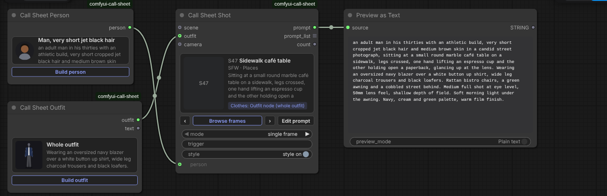

The node shows the frame, **Browse frames** and **‹ ›** to step through frames, **Edit prompt**, and the same mode, trigger and style settings as the Call Sheet node. A tag on the card tells you when a linked node is changing the prompt (here, "Clothes: Outfit node (whole outfit)").

### The frame picker

**Browse frames** on the Shot node (or **Open full picker** in the Studio) opens the full frame picker.

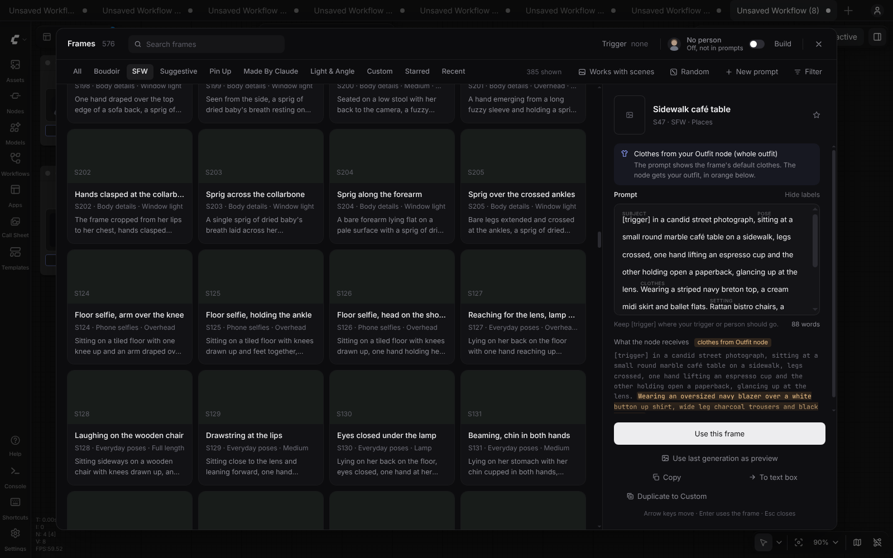

Along the top are the tabs, **Works with scenes** (only frames a scene can move), **Random**, **New prompt** and **Filter**, which narrows frames by set, camera angle and light. Click a frame to see its prompt on the right, where you can edit it before using it. **What the node receives** shows the final text with your linked nodes applied, with their parts highlighted. **Use this frame** sends it to the node. **To text box** sends the prompt into a text node instead.

Arrow keys move between frames, Enter uses the selected frame and Esc closes the picker.

### The sidebar

Click **Call Sheet** in ComfyUI's left sidebar to browse every frame as a list.

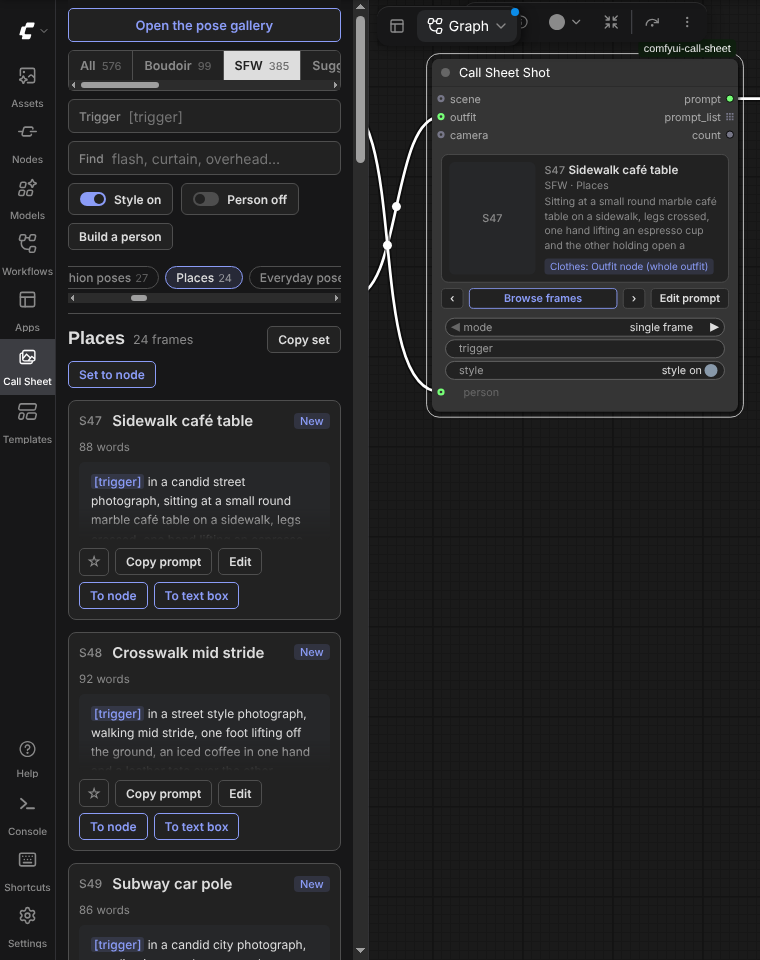

You can type a trigger once at the top, switch **Style** and **Person** on or off, and filter by tab and set. Each frame has:

- **Copy prompt** copies it to your clipboard.
- **To node** adds a Call Sheet Shot node set to that frame, or updates the selected one.
- **To text box** fills the selected text node. If nothing is selected, it finds the text node feeding your sampler. The button tells you where the prompt went.
- **Set to node** (next to a set's name) adds a Shot node that outputs the whole set as a list.

The sidebar is handy when you already have your own workflow and just want to drop a good prompt into it.

## 15. Tips and common questions

**My image doesn't match the prompt.** Krea 2 sometimes skips a detail, so try another seed. If that doesn't help, read the prompt at the bottom of the Studio. If two parts disagree (for example a night scene with "midday sun" still in it), pick a Lighting option on the Scene tab or a light look on the Camera tab so the old light sentence is replaced.

**I changed something and ComfyUI didn't re-run.** Call Sheet tells ComfyUI when your custom prompts, places, items or choices change, so this should not happen. If it does, change the seed or press Run again.

**The prompt is too long.** It's fine. Krea 2 handles long prompts well, and the frames are written to be detailed. Cut whatever you don't care about with Edit prompt.

**Can I use my own LoRA?** Yes. Type its trigger in the Trigger box on the Pose tab, turn Person off (the LoRA already knows who it is), and turn Style words off if the LoRA has its own look.

**Where are my things saved?** Everything you add yourself stays on your computer, in the plugin folder: `custom_prompts.json`, `custom_choices.json`, `custom_places.json` and `custom_outfit_items.json`, plus your preview images in `thumbs`. Saved people, outfits and scenes, stars and Studio settings are stored in your browser. Nothing is uploaded, and updates don't touch any of it.

**How do I update?** In ComfyUI Manager click **Update** on Call Sheet, or run `git pull` in its folder. Restart ComfyUI and hard refresh your browser (Ctrl+F5).

**Update fails, or says the histories are unrelated.** The plugin's history was rebuilt on November 23, 2026 (version 1.20.4), so installs from before that date can't update in place. Install it fresh once:

1. Close ComfyUI.
2. In `ComfyUI/custom_nodes/comfyui-call-sheet`, copy these to somewhere safe (only the ones you have): `custom_prompts.json`, `custom_choices.json`, `custom_places.json`, `custom_outfit_items.json` and the `thumbs` folder.
3. Delete the `comfyui-call-sheet` folder.
4. Install again as in [section 1](#1-install).
5. Put your copied files and the `thumbs` folder back in the new `comfyui-call-sheet` folder.
6. Start ComfyUI and hard refresh your browser (Ctrl+F5).

Saved people, outfits and scenes, stars and Studio settings live in your browser, so they aren't affected.
